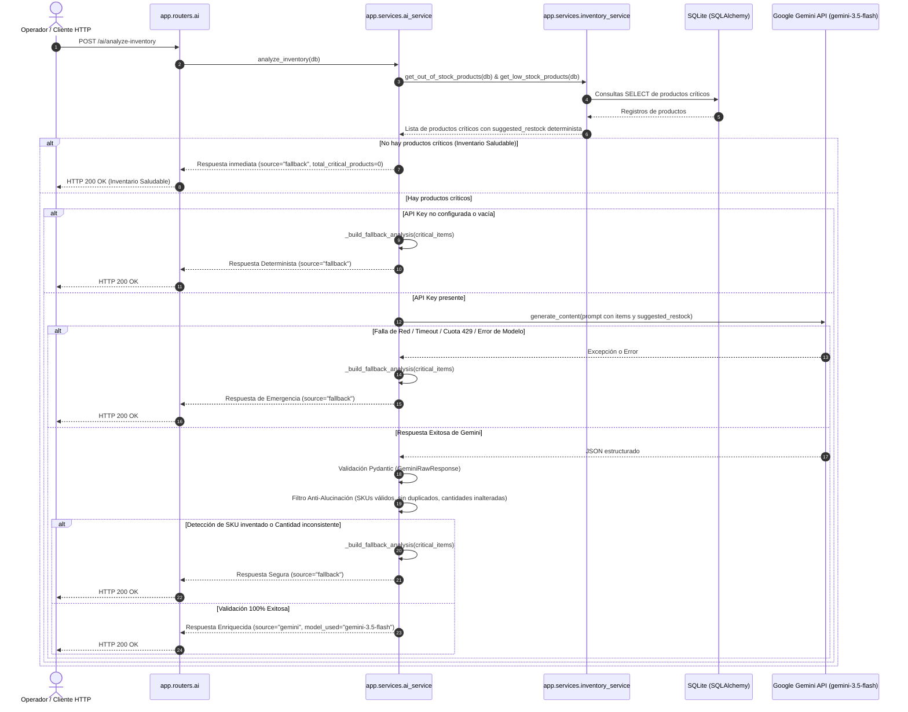

# Arquitectura del Sistema - RetailFlow AI

## 1. Visión General del Dominio y Problema de Negocio

En el sector de retail de gran escala (como cadenas de supermercados e hipermercados al estilo Carrefour), la disponibilidad de productos en góndola (*On-Shelf Availability*) y el control de inventario son factores críticos:
- Un **quiebre de stock** (*stockout*) deriva en pérdida directa de ventas, degradación de la experiencia del cliente y costos logísticos reactivos.
- Por otro lado, el **sobrestock** inmoviliza capital de trabajo y eleva el costo de almacenamiento o riesgo de merma.

**RetailFlow AI** fue concebido bajo un principio de **arquitectura híbrida defensiva**:
> **Las decisiones cuantitativas y críticas de inventario se rigen por lógica determinista en el backend, mientras que la Inteligencia Artificial Generativa se aprovecha exclusivamente para tareas de síntesis semántica, priorización contextual y enriquecimiento explicativo.**

---

## 2. Arquitectura por Capas

El backend está estructurado siguiendo una separación clara de responsabilidades en capas desacopladas, lo que facilita el mantenimiento, la extensibilidad y la testeabilidad unitaria e integradora.

```
┌────────────────────────────────────────────────────────┐
│                   Cliente / UI / API                   │
└───────────────────────────┬────────────────────────────┘
                            │ HTTP Requests
                            ▼
┌────────────────────────────────────────────────────────┐
│              Capa de Enrutamiento (Routers)            │
│  app/routers/health.py    app/routers/products.py      │
│  app/routers/inventory.py app/routers/ai.py            │
└───────────────────────────┬────────────────────────────┘
                            │ Dependencias / Inyección
                            ▼
┌────────────────────────────────────────────────────────┐
│              Capa de Servicios (Services)              │
│  app/services/inventory_service.py                     │
│  app/services/report_service.py                        │
│  app/services/ai_service.py                            │
└──────────────┬─────────────────────────┬───────────────┘
               │                         │
               ▼                         ▼
┌──────────────────────────────┐  ┌──────────────────────┐
│  Capa de Datos y Persistencia │  │   Gemini API (Cloud) │
│  app/models/product.py       │  │   google-genai SDK   │
│  app/database.py (SQLAlchemy)│  └──────────────────────┘
│  SQLite (retailflow.db)      │
└──────────────────────────────┘
               ▲
               │ Validación y Tipado
┌──────────────┴─────────────────────────────────────────┐
│              Capa de Esquemas y DTOs (Schemas)         │
│  app/schemas/product.py   app/schemas/inventory.py     │
│  app/schemas/ai.py                                     │
└────────────────────────────────────────────────────────┘
```

### Responsabilidades por Capa

| Capa | Ubicación | Responsabilidad Principal |
| :--- | :--- | :--- |
| **Routers (Controladores)** | `app/routers/` | Exposición de endpoints REST, serialización HTTP, inyección de sesión de BD mediante `Depends(get_db)` y mapeo de códigos de estado HTTP. No contiene lógica de negocio pesada. |
| **Services (Lógica de Negocio)** | `app/services/` | Orquestación de reglas de negocio puras, cálculos de reposición de stock, generación de reportes CSV y gestión de comunicación y fallback con Gemini API. |
| **Schemas (DTOs y Validación)** | `app/schemas/` | Definición de contratos de entrada y salida mediante Pydantic v2. Garantiza tipos estrictos, restricciones de valor (`ge=0`), contratos JSON de IA y esquemas para OpenAPI. |
| **Models (Persistencia ORM)** | `app/models/` | Definición del esquema relacional en SQLAlchemy 2.0 moderno utilizando `Mapped` y `mapped_column`. |
| **Database & Config** | `app/database.py`, `app/config.py` | Configuración del motor de base de datos, sesiones y lectura de variables de entorno mediante `pydantic-settings`. |

---

## 3. Flujo de Datos: Análisis Inteligente de Inventario

El flujo que atraviesa el endpoint `POST /ai/analyze-inventory` ejemplifica la resiliencia del sistema:



---

## 4. El Mecanismo de Fallback Determinista

En un entorno retail de misión crítica, una falla en un servicio externo de IA no puede detener las operaciones del centro de distribución ni bloquear el abastecimiento de las sucursales.

El **Fallback Determinista** garantiza que ante cualquier contingencia:
1. **Regla de Priorización Basada en Ratios:**
   - Si `stock == 0`: Prioridad `CRITICAL` (quiebre total de producto).
   - Si `stock > 0` y `stock / minimum_stock <= 0.5`: Prioridad `HIGH` (stock por debajo de la mitad del mínimo).
   - Si `stock / minimum_stock > 0.5`: Prioridad `MEDIUM` (reposición preventiva).
2. **Cálculo de Cantidad Invariable:**
   - `suggested_quantity = max(minimum_stock - stock, 0)` calculado estrictamente por el backend.
3. **Respuesta Transparente:**
   - El cliente recibe HTTP 200 con el atributo `source: "fallback"` y `model_used: null`, permitiendo auditar cuándo intervino la IA y cuándo operó el motor de reglas.
4. **Protección de Datos:**
   - La IA nunca interactúa con permisos de escritura sobre la base de datos (`retailflow.db`). Es un consumidor de solo lectura en memoria.

---

## 5. Decisiones Técnicas y Trade-offs

### SQLite vs. Motor Cliente-Servidor (PostgreSQL)
- **Decisión:** Utilizar SQLite local con SQLAlchemy 2.0.
- **Trade-off:** Para el alcance de este portafolio, SQLite simplifica radicalmente la reproducibilidad local (sin necesidad de levantar contenedores o configurar credenciales de bases de datos externas). Al mismo tiempo, el uso de SQLAlchemy 2.0 desacopla completamente el modelo relacional, lo que permitiría migrar a PostgreSQL en producción cambiando únicamente la cadena `DATABASE_URL` en `.env`.

### Cálculos en Backend vs. Delegación de Cantidades a la IA
- **Decisión:** Fijar y validar estrictamente las cantidades sugeridas desde Python.
- **Trade-off:** Se restringe la "libertad" generativa del modelo a favor de consistencia contable y auditoría de inventario. Los modelos LLM son propensos a variaciones numéricas estocásticas incompatibles con la exactitud requerida en finanzas y logística de retail.

### Pydantic v2 para Validación Estricta
- **Decisión:** Uso exhaustivo de Pydantic v2 (`ConfigDict`, `Field(ge=0)`, `model_validate`).
- **Trade-off:** Curva de migración respecto a Pydantic v1, pero aporta un incremento notable en rendimiento (núcleo en Rust) y tipado estático más predecible.

### Base de Datos Aislada en Memoria para Tests (`StaticPool`)
- **Decisión:** En `tests/conftest.py`, los tests utilizan `sqlite:///:memory:` con `StaticPool` y un ciclo de vida `create_all`/`drop_all` por test.
- **Trade-off:** Cada test se ejecuta en aislamiento absoluto en milisegundos, garantizando que ninguna prueba altere la base de datos de desarrollo `retailflow.db`.
