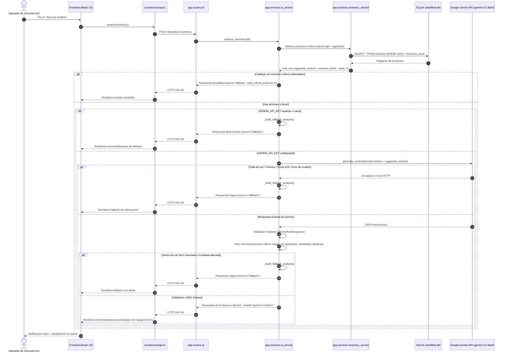

# Arquitectura del Sistema Full Stack - RetailFlow AI

Este documento describe la arquitectura técnica, los flujos de datos y las decisiones de diseño de **RetailFlow AI**, una plataforma Full Stack orientada a la gestión inteligente de inventarios, disponibilidad de producto en góndola y optimización logística en el sector retail.

---

## 1. Visión General del Dominio y Problema de Negocio

En el sector de retail y consumo masivo, la disponibilidad de producto en góndola (*On-Shelf Availability*) y la rotación eficiente de inventario son métricas neurálgicas:
- Un **quiebre de stock** (*stockout*) produce pérdida inmediata de ventas, deterioro de la experiencia de compra y costos reactivos de reposición urgente.
- El **sobrestock** genera inmovilización de capital de trabajo, congestión de depósitos en tienda y mayor merma por vencimiento o deterioro.

**RetailFlow AI** resuelve este equilibrio mediante una **arquitectura Full Stack híbrida y defensiva**:
> **Las cantidades de reposición de inventario se calculan estrictamente mediante reglas deterministas en el backend Python, mientras que la Inteligencia Artificial (Google Gemini) se utiliza para aportar análisis contextual, resumen ejecutivo y priorización operativa.**

---

## 2. Arquitectura por Capas Full Stack

El sistema se divide en dos subsistemas principales fuertemente tipados y desacoplados:

```
┌─────────────────────────────────────────────────────────────────┐
│                    CLIENTE WEB (FRONTEND)                       │
│                   React 18 • Vite • TypeScript                  │
│                                                                 │
│  [Layout & Sidebar]      [Dashboard & KPIs]    [ProductTable]   │
│  [CriticalInventory]     [AiAnalysisPanel]     [Modals & Toasts]│
│                                                                 │
│                   src/services/api.ts (Fetch API)               │
└────────────────────────────────┬────────────────────────────────┘
                                 │ HTTP / JSON / Blobs
                                 │ CORS [localhost:5173]
                                 ▼
┌─────────────────────────────────────────────────────────────────┐
│                    API REST (BACKEND FASTAPI)                   │
│                                                                 │
│  ┌───────────────────────────────────────────────────────────┐  │
│  │                   Routers (Controladores)                 │  │
│  │   /health     /products     /inventory     /ai            │  │
│  └─────────────────────────────┬─────────────────────────────┘  │
│                                │ Inyección Depends(get_db)       │
│                                ▼                                 │
│  ┌───────────────────────────────────────────────────────────┐  │
│  │                 Services (Lógica de Negocio)              │  │
│  │   inventory_service.py   report_service.py  ai_service.py │  │
│  └───────────────┬───────────────────────────┬───────────────┘  │
│                  │                           │                  │
│                  ▼                           ▼                  │
│  ┌───────────────────────────────┐ ┌─────────────────────────┐  │
│  │   Models & Persistencia ORM   │ │  Pydantic v2 Schemas    │  │
│  │   SQLAlchemy 2.0 (Mapped)     │ │  Validación de entrada  │  │
│  │   app/models/product.py       │ │  y serialización salida │  │
│  └───────────────┬───────────────┘ └─────────────────────────┘  │
└──────────────────┼──────────────────────────────────────────────┘
                   │                               │ google-genai SDK
                   ▼                               ▼
     ┌───────────────────────────┐   ┌───────────────────────────┐
     │   SQLite (retailflow.db)  │   │     Google Gemini API     │
     │    Almacenamiento Local   │   │    (gemini-3.5-flash)     │
     └───────────────────────────┘   └───────────────────────────┘
```

### Responsabilidades por Capa

| Subsistema | Módulo / Capa | Responsabilidad Principal |
| :--- | :--- | :--- |
| **Frontend** | `src/components/` | Componentes visuales responsivos con Tailwind CSS y Lucide React (KPIs, tablas filtrables, modales de confirmación, badges de prioridad). |
| **Frontend** | `src/services/api.ts` | Abstracción de llamadas HTTP con Fetch API, tipado estricto con TypeScript, mapeo de errores HTTP (409, 422, 500) y descarga de blobs CSV. |
| **Frontend** | `src/types/` | Contratos TypeScript espejo de los esquemas Pydantic del backend (`Product`, `InventoryItem`, `InventoryAnalysisResponse`). |
| **Backend** | `app/routers/` | Recepción de solicitudes HTTP, parseo de parámetros, inyección de sesión de BD (`Depends(get_db)`) y respuesta con códigos de estado HTTP semánticos. |
| **Backend** | `app/services/` | Reglas de negocio puras: clasificación matemática de inventario, exportación de reportes CSV y orquestación resiliente con Gemini AI / Fallback. |
| **Backend** | `app/schemas/` | DTOs de validación con Pydantic v2: restricciones numéricas no negativas (`ge=0`), contratos JSON estructurados para la IA y serialización ORM. |
| **Backend** | `app/models/` | Modelado relacional en SQLAlchemy 2.0 con anotaciones tipadas `Mapped` y `mapped_column`. |
| **Backend** | `app/database.py` | Configuración del motor relacional, pool de conexiones y generador de sesiones transaccionales por petición (`yield db`). |

---

## 3. Flujo de Datos: Comunicación React ↔ FastAPI ↔ Gemini / SQLite

El siguiente diagrama detalla la interacción integral durante una sesión de análisis asistido de inventario:



---

## 4. Estrategia de Seguridad y Mitigación de Alucinaciones

### 1. Inmutabilidad de Cantidades Críticas
Los modelos de lenguaje grandes (LLMs) presentan naturaleza probabilística y estocástica, lo que los hace vulnerables a variaciones numéricas inconsistentes. En RetailFlow AI:
- La IA **no decide ni recalcula** las unidades a comprar.
- Si Gemini devuelve una cantidad distinta a la calculada por el backend en `suggested_restock`, el backend detecta inmediatamente la discrepancia y conmuta a **fallback determinista**.

### 2. Filtro Anti-Alucinación de SKUs
El backend mantiene un índice en memoria (`backend_expected`) de los productos enviados. Si la respuesta del modelo incluye un código SKU inexistente o inventado, la respuesta completa es rechazada y se activa el fallback determinista.

### 3. Aislamiento de Base de Datos
La IA opera en modo de **solo lectura en memoria**. No posee permisos, rutas ni funciones que le permitan ejecutar sentencias `INSERT`, `UPDATE` o `DELETE` sobre SQLite.

### 4. Protección de Credenciales
- La clave `GEMINI_API_KEY` reside en el entorno de ejecución del backend.
- El frontend desconoce la clave privada y se comunica únicamente con el endpoint intermediario autenticado del backend.
- Los logs del backend suprimen cualquier impresión de credenciales ante excepciones de red.

---

## 5. Decisiones Técnicas y Trade-offs

| Decisión Técnica | Alternativa Evaluada | Justificación del Trade-off |
| :--- | :--- | :--- |
| **Fetch API nativo en Frontend** | Axios / React Query | Reducción de dependencias externas. Para el volumen y operaciones del sistema, Fetch con un wrapper tipado (`src/services/api.ts`) otorga control total, cero overhead y fácil mantenimiento. |
| **Tailwind CSS Utility-First** | CSS Modules / Styled Components | Desarrollo rápido de una interfaz SaaS moderna, diseño responsivo predecible y optimización automática del bundle final (24.4 kB de CSS gzippeado en 5 kB). |
| **Vite sobre CRA** | Create React App | Compilación incremental y HMR instantáneo en desarrollo, con build de producción en menos de 3 segundos para 1600+ módulos. |
| **SQLite con SQLAlchemy 2.0** | PostgreSQL en contenedor | Portabilidad inmediata sin requerir infraestructura cloud ni Docker local para evaluar el proyecto. El uso de SQLAlchemy 2.0 desacopla el código relacional, permitiendo migrar a PostgreSQL en producción cambiando únicamente `DATABASE_URL`. |
| **Testing con SQLite en memoria y `StaticPool`** | Mockear SQLAlchemy con MagicMock | Probar contra una base de datos SQLite real en memoria asegura que las consultas SQL, filtros, ordenamientos y transacciones se evalúen contra un motor relacional real sin alterar la base de datos de desarrollo. |
